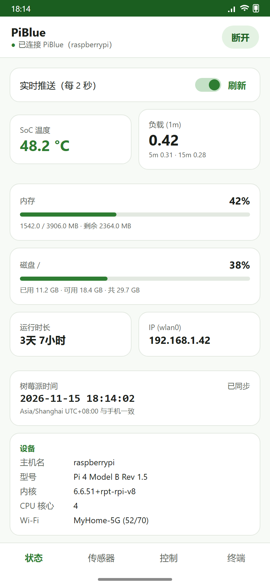
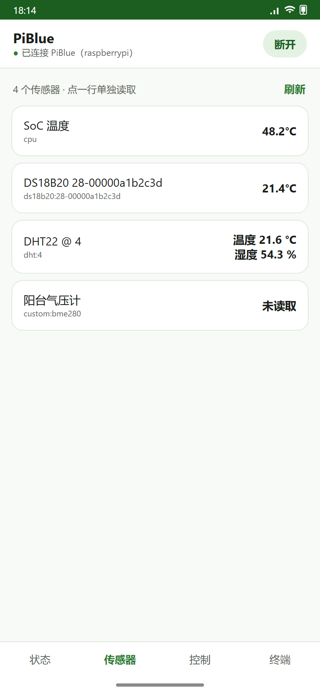
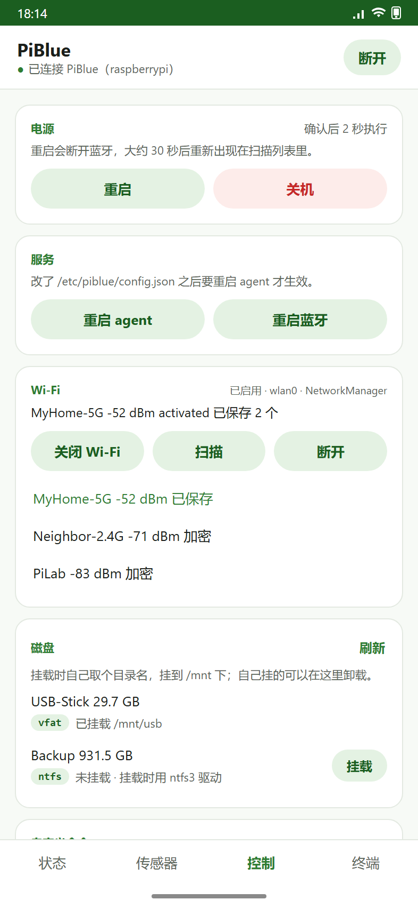
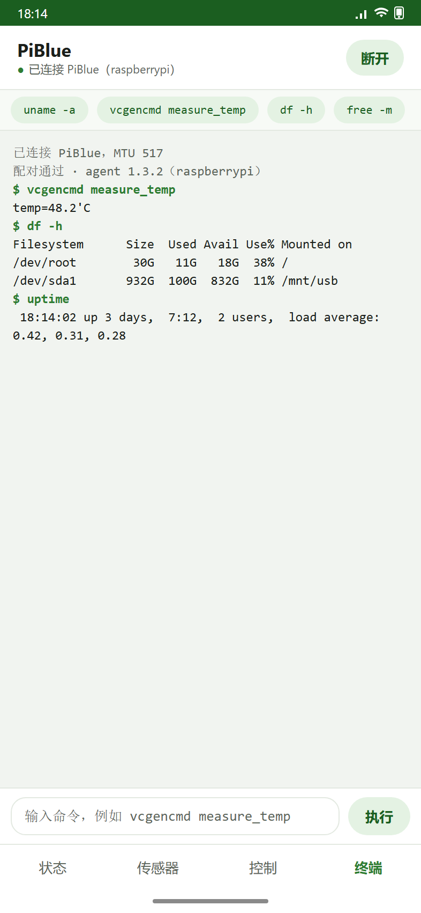

# PiBlue · 手机通过蓝牙查看与控制树莓派

树莓派上跑一个 Python 写的 BLE GATT 服务，手机装一个 Kotlin 原生 App，连上去就能看系统状态、读传感器、控制磁盘和 Wi-Fi、执行终端命令。

```
┌──────────────┐   BLE (GATT, 无需配对)   ┌─────────────────────────┐
│  Android App │ ◀══════════════════════▶ │  树莓派                  │
│  Kotlin      │   RX: JSON 命令（分片写）│  bless → GATT server     │
│  原生 View UI│   TX: JSON 回包（notify）│  Agent → handlers        │
└──────────────┘                          │   ├ sysinfo  系统快照    │
                                          │   ├ shell    命令白名单  │
                                          │   ├ control  重启/磁盘/Wi-Fi│
                                          │   └ sensors  探头/自定义 │
                                          └─────────────────────────┘
```

* **不需要同一个 Wi-Fi**，也不需要提前蓝牙配对，连上就能用。
* **不需要公网**，不经过任何服务器，手机直连树莓派。
* 手机端装好就是四个页面：状态、传感器、控制、终端。

| 状态 | 传感器 | 控制 | 终端 |
| --- | --- | --- | --- |
|  |  |  |  |

图里的数据是示例（Pi 4 + 一个 DS18B20 / DHT22），版式与文案按 app 真实布局渲染。

---

## 快速开始

### 1. 树莓派端

需要树莓派 3B+ / 4 / 5，Raspberry Pi OS Bookworm 或 Bullseye，能 SSH 进去。

```bash
# 在电脑上（Windows 用 Git Bash）：克隆仓库，把 agent 传上去
git clone https://github.com/xiejx/piblue.git
cd piblue
scp -r pi-agent pi@raspberrypi.local:~/
ssh pi@raspberrypi.local
```

**先试调试模式**（不往系统里写任何东西，前台运行，Ctrl-C 停）：

```bash
cd ~/pi-agent
sudo ./scripts/dev.sh
```

跑通了再正式安装（放到 `/opt/piblue`、配置进 `/etc/piblue`、注册 systemd 开机自启）：

```bash
sudo ./scripts/install.sh
```

装完会打印一个**配对码**（形如 `ABCD-EFGH-JKLM-NPQR`），手机第一次连接时填一次。忘了随时查：

```bash
sudo piblue-token             # 看当前配对码
sudo piblue-token new         # 换一个（所有手机都要重填）
sudo systemctl restart piblue # 换完必须重启，否则服务仍用旧码
```

`new` / `set` 只改 `/etc/piblue/token`，而配对码是在进程启动时读进内存的，不重启新码不生效 —— 细节见 [docs/agent-install.md](docs/agent-install.md#new--set-之后必须重启服务)。

最后自检，全绿就说明树莓派已经在广播 `PiBlue` 了：

```bash
sudo ./scripts/doctor.sh
```

> 细节（两种模式的差异、`config.json` 每个字段、多台树莓派怎么区分、不装 App 怎么验证链路）：[docs/agent-install.md](docs/agent-install.md)

### 2. 手机端

从 [Releases](https://github.com/xiejx/piblue/releases) 下载 `PiBlue-<版本>-debug.apk`，开 USB 调试后：

```bash
adb install -r PiBlue-1.3.3-debug.apk
```

也可以直接把 APK 传到手机上点安装。要自己构建（需要 JDK 17 + Android SDK Platform 34）：

```bash
cd android
./gradlew assembleDebug     # 产物：app/build/outputs/apk/debug/app-debug.apk
```

> 完整环境要求、`./build-apk.sh` 封装、打 tag 自动出包的流程：[docs/android.md](docs/android.md)

### 3. 连上

1. App 打开 → 点「扫描并连接」，第一次会申请蓝牙权限
2. 列表里选 `PiBlue`（多台同名设备时看第二行的 MAC）
3. 填一次配对码
4. 标题栏变成 `已连接 PiBlue（主机名）`，四个页面就有数据了

---

## 日常使用

| 页面 | 一句话 |
| --- | --- |
| **状态** | 温度、负载、内存/磁盘、运行时长、树莓派时间与 NTP 状态、IP、型号；右上角可开「每 2 秒实时推送」 |
| **传感器** | 自动发现 DS18B20 / DHT / 自定义脚本，点卡片单独读，右上角刷新全部 |
| **控制** | 重启/关机、重启服务、Wi-Fi 开关与连接、磁盘挂载与卸载、最多 5 条自定义命令（点名字执行，输出直接弹出来） |
| **终端** | 输入命令回车执行，stdout / stderr / 退出码分开显示，顶部有几个常用只读命令的 chip |

两个容易忽略的点：

* **控制页的按钮是树莓派下发的**，不是写死在 App 里。在 `config.json` 的 `control.allow` 里删掉 `"shutdown"`，那个按钮就从手机上消失，不用重装 App。
* **终端页受白名单约束**，`rm` 之类永远拒绝，管道默认也不许。要放宽得改配置（见下面「安全」）。

---

## 安全：先读这三行

1. 蓝牙广播是公开的：**任何人开着扫描都能看到并连上你的树莓派**，挡不住。
2. 真正的关卡是**配对码**（挑战-响应 + HMAC，码本身不过蓝牙），连错 5 次锁 60 秒。
3. 但认证通过就等于拿到 root：`exec` 的白名单是防手滑的护栏，不是沙箱。

所以：只在自家环境用；不用的时候 `sudo systemctl stop piblue`；把配对码当成这台机器的开机密码对待。

> 完整威胁模型、`exec` 的三层锁、BLE 到底能泄露哪些信息：[docs/security.md](docs/security.md)

---

## 遇到问题

先跑 `sudo ./scripts/doctor.sh`。几个最常见的：

| 现象 | 多半是 |
| --- | --- |
| 扫不到设备 | 蓝牙服务没起，或树莓派被别的设备连着：`sudo systemctl status bluetooth`、`journalctl -u piblue -n 40` |
| 连上了但命令没反应 | 配对码没填/填错，状态栏会显示「已连接（未配对）」 |
| 显示 MTU 517 但每条命令都超时 | 单向超长 notify 被 BlueZ 丢了，`hello` 握手 + 分片修复；用 `sudo btmon` 分辨方向 |
| 打开几秒后闪退 | 旧包的 `ListenableFuture` 缺类问题，1.3.x 已修 |
| 脚本报 `set: pipefail: invalid option name` | 文件被拷成了 Windows 行尾（CRLF） |

> 三十多条症状对照、`btmon` 怎么读、挂载/Wi-Fi 的具体报错：[docs/troubleshooting.md](docs/troubleshooting.md)

---

## 文档

安装与使用的主干留在本文件，细节按主题拆到 `docs/` 下：

| 文件 | 内容 |
| --- | --- |
| [docs/agent-install.md](docs/agent-install.md) | 树莓派端完整安装、`config.json` 全字段、配对码管理、多台设备、链路自测 |
| [docs/android.md](docs/android.md) | 环境要求与构建命令、打 tag 自动出包、权限、四个页面的细节 |
| [docs/control.md](docs/control.md) | 控制页动作表、磁盘挂载规则（含 NTFS）、自定义命令、Wi-Fi 行为 |
| [docs/security.md](docs/security.md) | 安全边界：BLE 挡得住什么、`exec` 三层锁、能拿到手机的哪些信息 |
| [docs/troubleshooting.md](docs/troubleshooting.md) | 排错速查、超时定位、启动闪退的来龙去脉 |
| [docs/protocol.md](docs/protocol.md) | 协议细则：分帧、命令与回包、认证、MTU 分片 |
| [docs/status.md](docs/status.md) | 哪些验证过、哪些只跑了模拟器、后续能往哪长 |

---

## 仓库结构

```
piblue/
├─ pi-agent/        树莓派端（Python + bless）
│  ├─ agent/        入口、GATT 服务、命令分发、分帧、handlers/
│  ├─ scripts/      dev.sh / install.sh / uninstall.sh / doctor.sh
│  └─ tools/        simulator.py（不开蓝牙，用 stdin/stdout 跑同一套逻辑）
├─ android/         手机 App（Kotlin，原生 View）
├─ .github/         CI：推 tag 自动构建 APK 并挂到 Release
└─ docs/            详细文档（本文件的详细版都在这里）
```

---

## 版本

App 1.3.3（versionCode 8）/ agent 协议 1.3.3。当前状态与未验证项见 [docs/status.md](docs/status.md)。

---

## 许可

[MIT](LICENSE)。拿去改、拿去商用都行，保留版权声明即可。

> 这个工具以 root 身份在树莓派上执行命令，默认开着蓝牙广播。装之前请读完 [docs/security.md](docs/security.md)，配对码是唯一的关卡。

