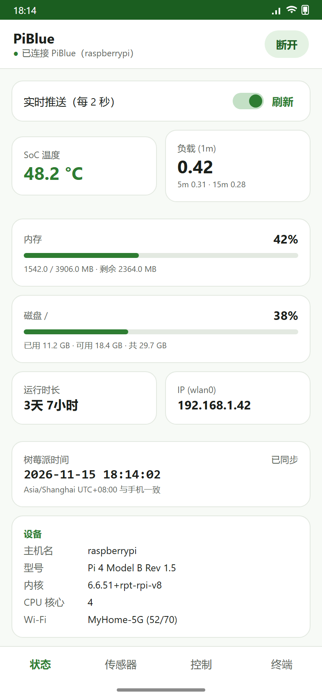
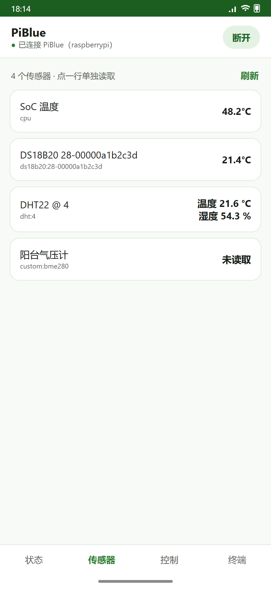
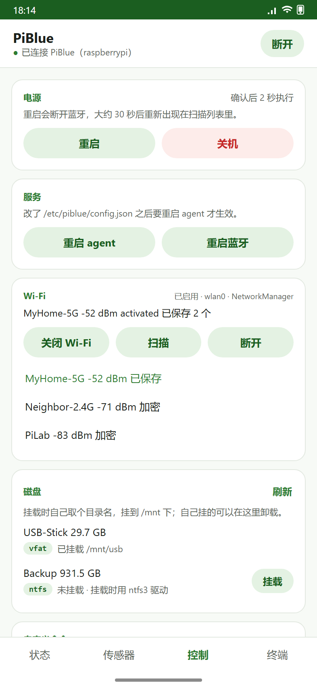
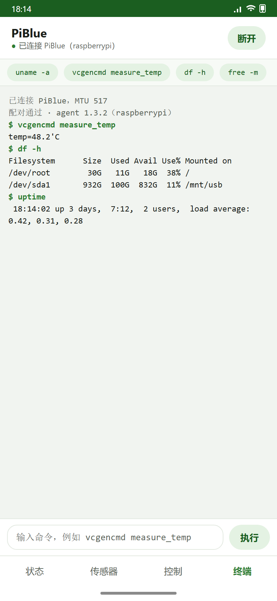

# 手机端：安装与构建

## 装现成的包

打 tag 后由 GitHub Actions 自动出包，产物挂在 [Releases](https://github.com/xiejx/piblue/releases) 页，命名 `PiBlue-<版本>-debug.apk`。下到电脑上，开 USB 调试后：

```bash
adb install -r PiBlue-1.3.3-debug.apk
```

`adb` 在 Android SDK 的 `platform-tools` 里。没装 SDK 也可以直接把 APK 传到手机上点安装（需要允许"安装未知来源应用"）。

> 仓库里**不放** APK（`.gitignore` 挡掉了 `*.apk`），二进制会随每次构建把 git 历史撑大。要哪个版本去 Releases 拿。

---

## 自己构建

### 环境要求

| 组件 | 版本 | 说明 |
| --- | --- | --- |
| **JDK** | 17 | AGP 8.5 要求 17+，21 也能跑。Temurin / OpenJDK / Android Studio 自带的 JBR 都行 |
| **Android SDK Platform** | 34（Android 14） | `compileSdk = 34`、`targetSdk = 34` |
| **Android SDK Build-Tools** | 34.0.0 | `aapt2` / `d8` / `zipalign` 等 |
| **Gradle** | 8.7 | **不用预装**，wrapper 首次运行会自动下载 |
| **磁盘** | 约 2 GB | Gradle 缓存 + SDK 组件 + 构建产物 |
| **网络** | 首次构建需要 | 下载 Gradle 发行版与 AGP / Kotlin 依赖；装好之后可以离线构建 |
| **系统** | Linux / macOS / Windows | Windows 上 `./gradlew` 需要 Git Bash，cmd / PowerShell 用 `gradlew.bat` |

JDK 与 SDK 按下面的顺序查找，找到第一个能用的就停：

| 工具 | 查找顺序 |
| --- | --- |
| JDK | `$JAVA_HOME` → PATH 上的 `java` → Android Studio 自带的 JBR |
| Android SDK | `$ANDROID_HOME` / `$ANDROID_SDK_ROOT` → `local.properties` 里的 `sdk.dir` → 各系统默认路径（`%LOCALAPPDATA%\Android\Sdk`、`~/Library/Android/sdk`、`~/Android/Sdk`） |

SDK 里缺 Platform 34 的话，用 SDK Manager 补：

```bash
sdkmanager "platforms;android-34" "build-tools;34.0.0"
```

### 构建命令

```bash
cd android

./gradlew assembleDebug      # 调试包，可直接安装
./gradlew assembleRelease    # 发布包，未签名
./gradlew clean              # 清掉本模块的 build/
```

产物固定在 `android/app/build/outputs/apk/debug/app-debug.apk`。

* Windows 上用 **Git Bash** 才能跑 `./gradlew`；cmd / PowerShell 里用 `gradlew.bat assembleDebug`，参数一样。
* 首次运行会下载 Gradle 8.7 发行版（约 130 MB），之后走 `~/.gradle` 缓存；加 `--offline` 可以强制离线。
* 构建日志太吵时加 `--console=plain`，想要更详细加 `--info`。

### 可选的封装脚本

`android/build-apk.sh` 是上面那几条命令的薄封装：自动定位 JDK / SDK，跑完把 APK 路径、体积和 `adb install` 命令打出来。

```bash
cd android
./build-apk.sh              # debug
./build-apk.sh release      # release（未签名）
./build-apk.sh clean
```

它和 `./gradlew` 做的事完全一样，只是少打字。定位不到环境时会直接说缺什么、怎么装。JDK / SDK 装在非常规位置就写进 `android/env.local`（已被 git 忽略，不会外泄本机路径）：

```bash
# android/env.local
JAVA_HOME=/c/Program Files/Android/Android Studio/jbr
ANDROID_HOME=/c/Users/me/AppData/Local/Android/Sdk
GRADLE_USER_HOME=/d/shared/gradle-home   # 可选：复用已有的依赖缓存
```

`GRADLE_USER_HOME` 指到一个构建过这个项目的缓存目录，就完全不用联网（下面「网络」一节提到的那类问题也能绕过）。

### 用 Android Studio

直接 Open `android/` 目录，Gradle JDK 选 17，Run 即可。`local.properties` 由 Studio 自己写，不用手工维护。

最低支持 Android 7.0（`minSdk = 24`），目标 API 34。

---

## 打 tag 自动出包

`.github/workflows/build-apk.yml`，推一个 `v*` 形式的 tag 就触发：

```bash
# 先把 app/build.gradle.kts 里的 versionCode / versionName 改成目标版本并提交
git tag v1.3.4
git push origin v1.3.4
```

流程：`ubuntu-latest` runner → Temurin JDK 17 → Android SDK Platform 34 + Build-Tools 34.0.0 → `./gradlew assembleDebug` → 校验 APK 的 `versionName` 与 tag 一致 → 改名 `PiBlue-1.3.4-debug.apk`、算 SHA256 → 传到 Release 附件，同时留一份 workflow artifact（保留 30 天）。

Android SDK 用的是 **runner 镜像自带的那份**（`ANDROID_HOME` 已经指好，`sdkmanager` 也在），只补装 Platform 34 和 Build-Tools 34.0.0。没有用 `android-actions/setup-android`——它会先自己再下一份 cmdline-tools，多一层失败点，1.3.3 首次尝试就是挂在那一步。如果哪天 runner 镜像变了、找不到 `ANDROID_HOME` 或 `sdkmanager`，那一步会直接报一条 `::error::` 注解说明缺什么。

两点必须注意：

* **tag 要和 `versionName` 对上**。CI 会用 `aapt dump badging` 读包里的版本号，和 tag 不一致就直接失败——宁可不出包，也别发出一个标题写 A、装上去是 B 的包。
* **`versionCode` 每次都要 +1**，否则手机上覆盖安装会失败（同一个 versionCode 装不进去）。`versionName` 是给人看的，`versionCode` 是给系统比的。
* **tag 一旦推上去、Release 建出来了，就别再改它**。`git tag -f` + 强推会让线上多出一个版本号相同的包，用户分不清该下哪个。要修就发新版本号。

构建失败时不用翻日志：Gradle 输出的最后 30 行会以注解（annotation）形式贴在 run 页面顶部，`sdkmanager` 装依赖失败也一样。

`workflow_dispatch` 也能手动跑（仓库 Actions 页 → Build APK → Run workflow），手动跑只出 artifact、不建 Release。

---

## 为什么 UI 是原生 View 而不是 Compose

依赖表只有 `core-ktx` 和 `coroutines` 两行，换来的东西不少：

* APK 约 2 MB，冷启动快，UI 就是 LinearLayout / TextView / ListView，这套控件十年内不会过时；
* 不需要 Compose 编译器插件，构建链路短，CI 上从零到出包一分钟左右；
* 依赖图小到可以手工钉死版本（见下），不会因为某个次级依赖升级就悄悄改行为。

代价是没有现成的 Material 组件和声明式状态管理，界面代码比 Compose 啰嗦。功能与交互没有区别。

## 依赖约束（别随手删）

这些都写在 `app/build.gradle.kts` 里，每一条都对应过一次构建失败或一次线上崩溃：

* 排除 `kotlin-stdlib-jdk7` / `kotlin-stdlib-jdk8`——1.8 之后这两个 artifact 已经是空壳，内容并进了 `kotlin-stdlib`；
* 把 `androidx.collection` / `androidx.annotation` 钉到确定版本，避免次级依赖把版本顶上去；
* `com.google.guava:listenablefuture` 直接 `exclude`，接口用源码补（`app/src/main/java/com/google/common/util/concurrent/ListenableFuture.java`）——**千万不要**改回 `force("listenablefuture:9999.0-empty-to-avoid-conflict-with-guava")`，那个 jar 是空的，只在完整 Guava 在 classpath 上时才成立；照抄会让 `androidx.profileinstaller` 在启动 5 秒后 `VerifyError` 崩掉。踩坑全程见 [troubleshooting.md](troubleshooting.md) 的「启动 5 秒后闪退」。

---

## 权限

* Android 12+：`BLUETOOTH_SCAN`（声明 `neverForLocation`）+ `BLUETOOTH_CONNECT`
* Android 11 及以下：`ACCESS_FINE_LOCATION`（老系统的 BLE 扫描被归到定位权限里）

App 只在第一次点"扫描并连接"时申请。

---

## 四个页面

| 页面 | 内容 |
| --- | --- |
| **状态** | SoC 温度、1/5/15 分钟负载、内存与磁盘占用（带进度条）、运行时长、**树莓派时间**（含时区、与手机的偏差、NTP 是否同步过）、IP、型号/内核/Wi-Fi、供电与降频告警。右上角可开关"每 2 秒实时推送"，开着时时间跟着一起走 |
| **传感器** | 自动列出可用传感器（SoC 温度、DS18B20、DHT、自定义脚本）。点卡片单独读一次，右上角刷新读全部 |
| **控制** | 重启 / 关机、重启 agent 与蓝牙服务、Wi-Fi 开关与连接（扫描附近网络、已保存的网络可直接点）、磁盘列表与挂载（每行标出**文件系统类型**，挂载目录名自己填，NTFS 走 `ntfs3`，卸掉自己挂的）、最多 5 条自定义命令（可在 App 里增删改；点执行后弹出这次的 stdout / stderr / 退出码 / 耗时，可复制）。**按钮由树莓派下发**，不是写死在 App 里 |
| **终端** | 输入命令回车执行，输出区分 stdout / stderr / 退出码；预置了几个常用只读命令的快捷 chip |

控制页的按钮由 `control` 的 `status` 驱动，所以**树莓派上增减动作不需要重装 App**，最坏情况只是新动作没有中文标签（会按动作名显示）。控制页能做什么见 [control.md](control.md)。

四页的样子（`docs/images/` 下的四张，数据是示例读数）：

| 状态 | 传感器 | 控制 | 终端 |
| --- | --- | --- | --- |
|  |  |  |  |

要换成自己机器的截图，手机连上树莓派后直接 `adb exec-out screencap -p > app-status.png` 覆盖同名文件即可，版式不用动。

---

## 代码在哪

```
android/
├─ build-apk.sh                       命令行构建的薄封装（等价于 ./gradlew）
├─ gradlew                             Gradle wrapper，钉 8.7
└─ app/src/main/java/com/raspi/piblue/
   ├─ ble/BleClient.kt                扫描 / 连接 / 分片写 / 按字节重组
   ├─ data/Models.kt                  JSON → 数据类
   ├─ data/Control.kt                 控制页的数据类（动作/磁盘/Wi-Fi）
   ├─ PiController.kt                 状态与命令，与 UI 解耦
   └─ MainActivity.kt                 原生 View 四页界面
```
